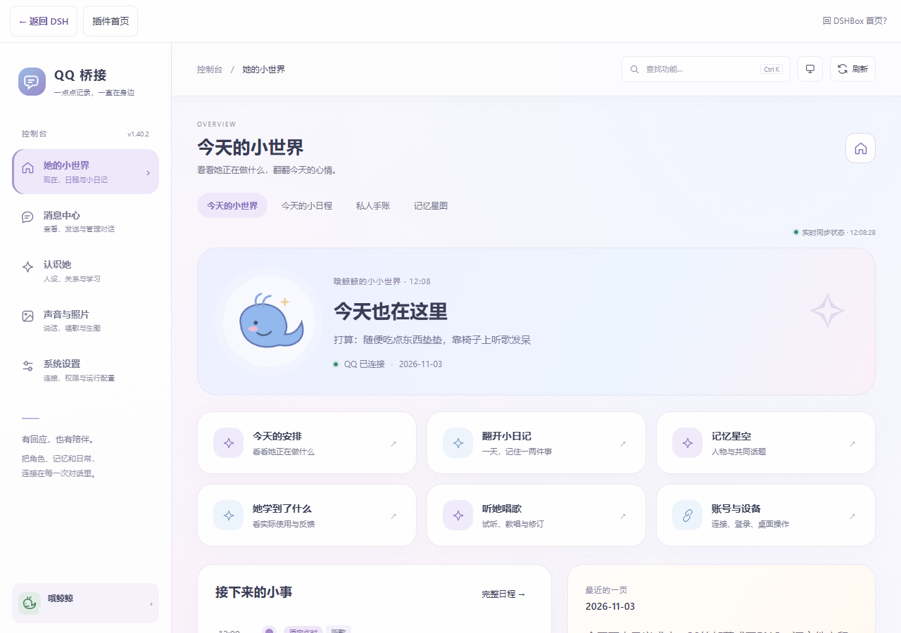
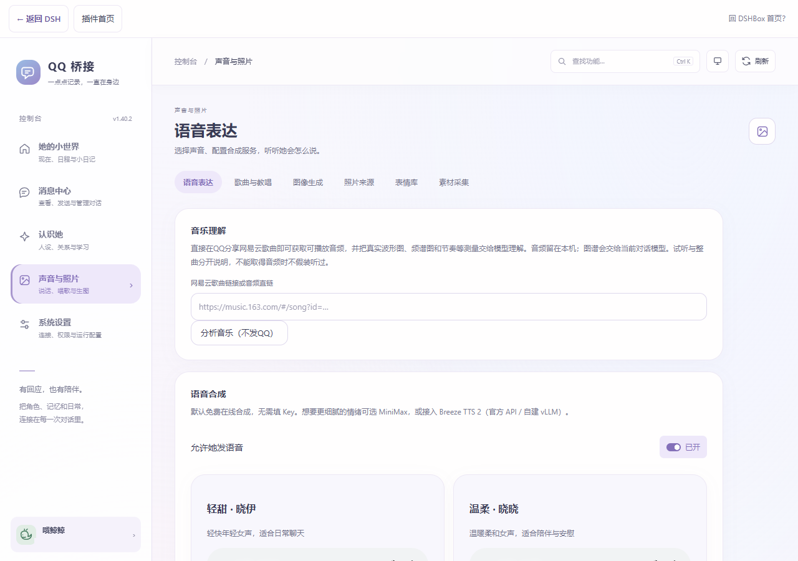
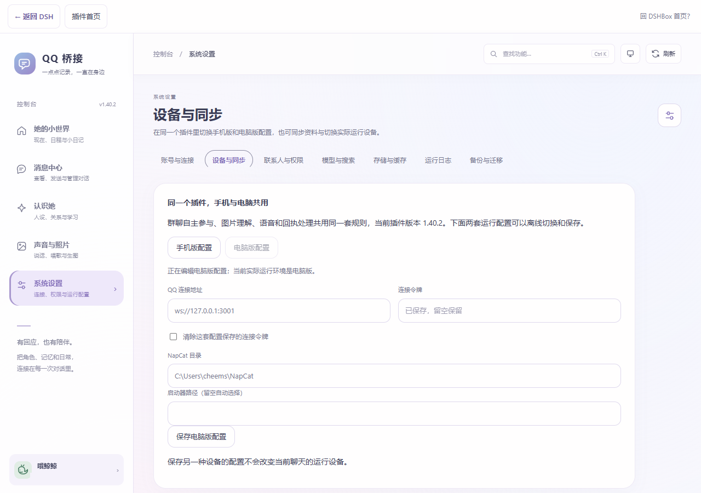

# dsh-im-bridge · QQ ⇄ DeepSeek Harness

把 DeepSeek Harness 接到 QQ 上：NapCat（OneBot 11）当网关，DSH 会话是她的脑子，QQ 是她的嘴。提供电脑和手机独立布局的管理面板。



> 她在 QQ 里跟你聊天时，背后是一个真正的 DSH Session：同一套记忆、同一套工具，只是出口换成了 QQ。

---

## 当前版本：1.58.4

1.58.4 增加电脑版固定浏览器程序路径（默认 Edge），指定失效不换用其他浏览器；同一视频和重定向链接复用页面，减少重复加载与刷新。顶部常驻“一键保存”按当前页提交设置，失败保留草稿，旧后台未加载更新时不假报路径已保存。模式切换增加未应用提示，本地能力检查保留失败原因。715项自动测试通过，没有真实生成或QQ发送。详见 [更新说明](docs/1.58.4-浏览器与顶部保存.md)。


1.58.3 将本地语音改为可选 VoiceLab、OpenAI 兼容和自定义同步 JSON 协议，支持自定地址、模型、音色、请求模板、音频回执和启动路径；区分 CPU/GPU 与 8GB 显存释放规则。修复电脑 QQ 登录状态对预先配置账号的循环依赖，区分 QQ 在线与桥接暂停。电脑/手机私人手账改为浅蓝白格纹。709 项自动测试通过，没有真实 QQ 发送或生成 API 调用。详见 [更新说明](docs/1.58.3-本地语音与登录.md)。


1.58.2为空间实际写入、签名接口和QQ发送队列增加主动社交保护：每次主动空间访问最多尝试一条评论/回复，自动签名每账号按北京时间每天最多尝试一次，主动联系全账号至少间隔30分钟且同一对话需先有新消息。多段分享按同一回合继续发送，主动分段至少间隔3秒；正常用户回复与明确要求的操作不受主动间隔限制。持久记录防止重启、换角色和切换主动动作绕过。空间总开关仍默认关闭，日程每天一次兴趣提醒保留。按用户选择，不增加通用浏览器或手机工具的空间拦截。700项测试通过，没有真实QQ发送、空间评论或生成API调用。


1.58.1新增QQ空间独立总开关，默认关闭，覆盖专用的登录维护、浏览、发布、评论及后台读回。修复开放策略强制重新开启空间发布/回复的问题。API日程改成每账号北京时间每天仅一次可放弃的空间兴趣提醒，普通探索不再另起空间任务，关闭时取消空间专用请求。每日提醒不等于评论条数限额；通用浏览器或手机操作仍须另行约束。695项测试通过，未进行真实空间访问或发布。账号处罚原因不能由代码检查推断，开启自动公开操作前请自行评估。


1.58.0 在PC/手机图像生成旁增加视频API配置，沿用连接检测与任意模型填写。与生图共用完整人设参考、当前服装/头饰、日程背景、画风及自拍视角，再追加时长、时序动作和镜头运动。bridge_video接通提交、任务进度、实际MP4下载及QQ持久发送队列；任务中断可以恢复，不重复提交。调用记录可查看完整提示词、参考图、任务和输出文件。支持兼容/videos的表单及相同字段JSON，不承诺自动适配所有私有协议；RunningHub保留工作流方式。本地/API隔离保留。689项测试通过，视频仅模拟验证，没有实际付费生成或QQ发送。更新源码后由本人自行重启。


1.57.3 删除后台空间评论轮询，改为按兴趣主动访问；新增真实好友目录、动态浏览及对已读动态的一级评论，保留回复、白名单与逐次读回。日程页增加PC/手机固定悬浮定位卡。作品、配话和完整链接按自然段分别排队，每段独立回执；普通API/本地链接回复同样分段，部分失败不整组重复。678项测试通过；没有真实发表评论或发QQ测试消息。源码更新保留资料，由本人自行重启。


1.57.2 扩充刷视频、游戏、解谜、探索网站与工具等日程灵感；无新请求打扰、未睡眠且条件允许时主动推进自己选定的目标，实现方法自行发现工具与探索。保留已有计划和执行机制，娱乐不强制报告或分享。667项回归及PC/手机隔离启动检查通过。


1.57.1 接通按真实QQ身份的跨群/私聊相关记忆，保留隐私范围与来源；连续相同日程时段在PC和手机合并显示。日程睡眠进入实际静默，临时唤醒后恢复休息；@后API/本地统一观察120秒，生成期间暂停倒计时。667项测试及PC/手机版日程排版检查通过。源码更新保留资料，由本人自行重启。


PC、手机版及本地聊天共用 `bridge_context` 按需读取服装、场景、详细日程、相关记忆、梗和功能说明。普通闲聊不每轮加载无关资料；被问到、准备主动提起或生图时读取最新状态。保留原人设、近期对话、情绪及原功能；照片后端仍自行读取场景与参考图。本地主动开口支持先取资料再决定发言。固定会话说明合成对照：PC 4376→1896字符，手机3724→2194字符，不代表等比例费用降幅。新增读取范围、过期资料、衣着连续性和照片规划测试；更新仅替换源码，保留资料，由本人自行重启。


1.56.1 修复合并转发仍只有文字目录的问题：收到转发或引用旧转发时，默认附上前两张真实原图，其余图片按目录继续读取；支持嵌套和内联转发。用手机两份真实群转发核对了原图进入候选输入的路径，635 项测试通过；未调用模型或发测试消息。

1.56.0 补齐群聊历史原图读取和25项常用QQ能力目录，增加消息与空间提交后的后台读回核对。接口接收、读回内容和收件人引用回复分别记录；未读回不自动重复发送，也不冒充收件人已读。历史图片需要支持视觉的模型；目录中尚未实测的能力明确标为 unknown。详见[1.56.0 验证说明](docs/verification-1.56.0.md)。

新增通用 API 连接和媒体搭配、本地模型工具调度、手机 API 模式、发送回执与调用输出记录。此版重点修复空间评论读取、公开配图风格及来源选择，改善动态和链接分享的个人感想表达，并恢复休息与选择性参与群聊。

视频使用实际播放器或持续解码时间窗，支持续读、暂停、跳转和停止；模型只分析实际收到的画面，不把局部窗口说成完整观影，未解码音轨不声称听过。

## 功能

### 对话与群聊

| 场景 | 具体行为 |
|---|---|
| 私聊 | 直接回复。换行保留在同一条里，只有确实想另起一条时才分条 |
| 群聊 | 默认不发言。被 @ 或轮到自己才进入判断；判断完仍可 `[skip]`，@ 不是必须开口 |
| 气泡 | 群聊每条回复可设 1–8 条，默认按语境自主决定 |
| 媒体 | 图片、语音、视频、QQ 转发都能读；读不到就说读不到，不编造内容 |
| 画与拍照 | 「画一个…」是她亲手画（`bridge_drawing`：建画布、起稿、上色、导出）；「拍照 / 照片 / 自拍」才走 AI 生图 |
| 表情 | 被逗、被撒娇、想补个情绪时会自己挑一张；`[表情包:名字]` / `[表情包:搜 关键词]` 也照旧；同一对话两条内不重复，一轮最多一张 |
| 失败 | 图或语音没发出去时，下一轮由她用自己的话说明，不念错误码；可能已发出时先不重发 |
| 主动 | 按事件和空闲意愿主动交流；「我先忙 / 晚安 / 别再发」会暂停追聊，下一条用户消息恢复 |
| 分条 | 私聊由她自己决定长短；拟真模式可放开单条字数与重复检测 |

### 自我 + cosplay 人设

```
自我层   空白起步，给梗库、人类对话样例、真实经历；靠相处长出性格   ← 永久，唯一
cosplay  人设卡：名字、称呼、口吻、小动作；可以换，也可以为空        ← 临时
场合     群聊/私聊、当下情绪                                       ← 每轮
```

- 卡片为空 = 做自己，不加载任何角色文本
- 换卡只换外壳，**记忆、情绪、学习属于同一个人**
- 每张卡可填参考图，生图时按「像不像这个人」保持脸部一致
- 试聊只在面板里预览，不经过 QQ，也不影响真实会话
- 人设会成长：每天交流足够时留一条短期观察，自然月归档后再固化成长期设定，可回退

### 记忆与成长

- 记忆星图：人物、共同话题、发生过的事，按场景分开
- 小日记：每天写一次日记；「她学到了什么」记录实际使用与反馈
- 记忆按「总结 + 本地检索」组织，不依赖向量库，数据不出本机
- 面板「长期记忆」里可压缩、清除、迁移

### 情绪

每轮只在**对方明显带情绪**时注入一行理解（≤60 字），例如：

```
【对方现在不耐烦】懒得解释，语气变硬或直接不回；不要讲道理、劝冷静。
```

没命中就是 0 token。情绪底色按事件注入，不再每条都塞。

### 日程

她可以自己写日程，槽位支持能力绑定：

```json
{
  "start": "15:00", "end": "15:20",
  "taskKind": "group",
  "groupIds": ["686030141"],
  "activity": "去群里蹲一会儿，有人聊游戏就搭两句",
  "leaveWhen": "没人说话超过 20 分钟就回来"
}
```

`taskKind` 可选：`group / draw / browse / listen / social / write / digital / sleep / rest / local`。到点不强制切换，用户当前请求优先；开始不等于完成，实际结果按工具证据记。

### 声音与音乐



- 音色：`轻甜·晓伊`、`温柔·晓晓` 等预设，一键试听再保存
- 合成方式：内置甜妹（免费在线）、MiniMax（按量计费）、Breeze TTS 2（官方 API / 自建 vLLM-Omni）、原有 Edge 音色、自定义 HTTP TTS
- 语气：跟随内容 / 自然 / 开心 / 轻柔安慰 / 低落 / 惊喜 / 认真
- 唱歌：Breeze 短段清唱（试验），旋律自由生成，原曲与长歌尚不保证
- 音乐理解：在 QQ 里分享网易云歌曲即可取到可播放音频，并把真实波形图、频谱图、节奏和调性候选交给模型；音频留在本机

### 设备控制与同步



- 浏览器：独立真实浏览器，可导航、点击、填表、截图、读字幕
- 桌面：Windows 输入与截图，先观察再操作，窗口坐标不跨设备混用
- 手机：通过 DSHBox Pilot 执行，权限最终由手机系统确认
- 同一个插件可保存手机版 / 电脑版两套配置，离线切换；「在手机运行 / 在电脑运行」决定实际运行设备
- 数据线一键同步：插件源码以版本号高的一端为准；资料按记录合并、去重；同名冲突保留双方副本；停用与删除标记优先

### 权限与操作账本

默认采用非支付操作开放模式，实际付款仍需确认准确商家、金额和目标。联系人与群聊白名单、停用窗口以及 B 站评论发布开关继续生效。操作和回执绑定当前账号、人设与任务；未知发送结果不会被当成失败自动重发。

工具可用不代表持续在线：角色可以按日程休息，群聊根据 @ 激活窗口、当前话题和发言意愿选择是否接话。

### 面板

- 电脑与手机使用各自布局，包含：她的小世界 / 消息中心 / 认识她 / 声音与照片 / 系统设置
- 实时状态、`Ctrl K` 搜索、主题跟随宿主
- 角色、记忆、语音、设备、日志、备份都在一个地方

---

## 安装

### 1. 前置

- 已安装 **DeepSeek Harness**
- 已安装 **NapCat**，并在其中开启 **WebSocket 服务端**（记下端口与 token）
- 一个能登录的 QQ 账号（建议小号）

### 2. 装插件

```sh
dsh plugin --profile <你的 profile> add /path/to/this/repo
```

或者把本仓库作为 bundle 引用进 profile 的 `cordis.patch.yml`。

### 3. 装人设（可选）

仓库里的 `assets/personae.json` 提供两张卡：

| 卡 | 作用 |
|---|---|
| 哦鲸鲸 | cosplay 用，只改口吻和称呼 |
| 不使用人设 | 空卡片，她只做自己 |

在面板「角色设定」导入即可；不导入也能用。

### 4. 首次启动

打开 **设置 → QQ 桥接**：

1. 填 WebSocket 地址与 token（默认 `ws://127.0.0.1:3001`）
2. 「联系人与权限」把自己的 QQ 加白名单并设为号主
3. 「账号与连接」点「本地快速登录」拉起 NapCat
4. 发一条消息，收到回复即通

---

## 运行模式与设备

- 电脑支持 API、本地模型和按能力搭配的媒体连接。纯本地模式默认不转 API，API 补全需单独开启。
- 手机版仅使用 API，保留聊天、人设、记忆、日程、情绪、工具与发送回执逻辑；设备切换后使用对应布局。
- 图片、语音和视频生成需要相应服务或工作流；Windows 的 `start-local-ai.bat` 可启动已配置的本地服务。
- 公开视频解码需要 FFmpeg。电脑优先从系统 PATH 自动发现，也可在面板或 `tools/media-runtime-desktop.json` 填写路径；增强下载需要另外配置 Python 环境。仓库不携带模型权重、运行环境或账号资料。
- QQ 空间为非官方接口，登录和返回结构可能变化。评论优先读取详情，失败时读取动态流内嵌预览；预览可能不含全部评论。发布成功回执不等于已读回验证。

当前版本与验证范围见 [更新记录](CHANGELOG.md)。

---

## 指令

| 指令 | 作用 |
|---|---|
| `/new` | 换新会话，保留记忆 |
| `/cancel` | 中止当前这轮 |
| `/帮助` | 列出号主可在聊天里改的设置 |
| `/档位 省 / 标准 / 高 / 最高` | 切思考深度 |
| `/记忆 压缩 / 清除` | 处理长期记忆 |
| `[表情包:名字]` / `[表情包:搜 关键词]` | 发表情 / 联网找图 |
| `[语音] …` | 合成语音 |
| `[查:词]` | 查资料再答 |

号主额外可用：`[发送:QQ号|内容]`、`[群发:内容]`、`[定时:分钟|QQ号|内容]`。

---

## 已知限制

- 一次只连一个机器人账号
- 部分能力偏 Windows：隐藏启动 NapCat、桌面控制、SAPI 兜底音色
- 语音识别与生图需要第三方 Key
- 视频只看抽样画面，不解析音轨
- 记忆是「总结 + 本地检索」，不是向量库
- 群聊日程执行器仍在完善，到点进入/退出目前按小时级触发

## 数据与隐私

- 设置：`~/.dsh/im-bridge/settings.json`
- 记忆：默认 `~/.dsh/im-bridge/memory-hub`，可在面板迁移
- 媒体引用：`~/.dsh/im-bridge/qq-media-refs.json`（保留 7 天）
- 所有数据只在本机，不上传

## 许可

MIT。第三方组件与数据见 `THIRD_PARTY_NOTICES.md`。

## English

A QQ (NapCat / OneBot 11) bridge for DeepSeek Harness: a blank self that grows through experience, swappable cosplay persona cards, emotion-aware replies, schedule-driven group participation, local memory with evidence, TTS/ASR, image generation, browser and desktop control, and a 28-page panel. Permissions default to per-action asks and can be made standing via `fullTrust`. Panel sessions (the DSH web UI) get the same owner device access by default; disable with `panelAccess: false`.
